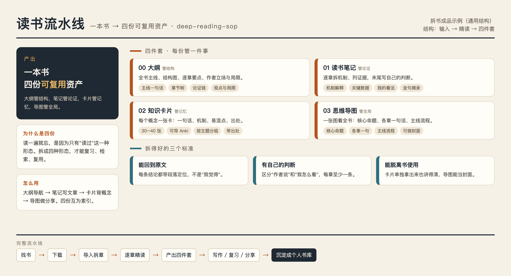

# 读书流水线 SOP（Deep Reading SOP）

用 **DSH（DeepSeek Harness）+ zlib + dsh-deep-reading** 把一本书拆成「大纲 / 读书笔记 / 知识卡片 / 思维导图」四件套，并整理成 FlowUs 书库的完整可复制方法。

> 目标不是"读过"，而是把书变成**可复习、可检索、可复用的知识资产**。



## 它能做什么

| 步骤 | 工具 | 产物 |
|---|---|---|
| 找书 | zlib CLI（Z-Library） | 选定版本 + 下载文件 |
| 拆章 | `dr_import` | 按章拆好的原文（带 `[n]` 段落锚点） |
| 精读 | `reading_chapter` | 每章讲解 + 章节记忆（原文不进主对话） |
| 四件套 | 手工整理 + Chrome 渲染 | `00 大纲` `01 笔记` `02 卡片` `03 导图` |
| 书库 | FlowUs | 主页 + 数据库 + 每本书详情页 |

## 三种人怎么用

| 你是 | 怎么开始 | 需要准备 |
|---|---|---|
| **只想看看** | 直接读这份 README 和 [SOP.md](SOP.md) | 什么都不用装 |
| **想要模板** | 点右上角 **Code → Download ZIP**，把 `templates/` 里四个 md 复制到 FlowUs / Notion / Obsidian | 一个笔记软件 |
| **想跑完整流程** | 按下面「前置依赖」装好 zlib、pnpm 和插件，再照「快速开始」走 | 一点命令行基础 |

> 新手建议：先手动拆一本 100 页以内的书，把"大纲 → 笔记 → 卡片 → 导图"四步跑通，再上自动化。

## 前置依赖

- [DSH](https://github.com/deepseek-ai/deepseek-harness)（插件系统与 `reading_chapter` 工具）
- [zlib](https://github.com/heartleo/zlib)（Z-Library 命令行，需自备账号登录）
- [dsh-deep-reading](https://github.com/Madao1210/dsh-deep-reading)（深度阅读插件）
- `pnpm`（DSH 插件安装依赖）
- Google Chrome（无头截图渲染思维导图）

## 快速开始

```bash
# 1. 安装 zlib
brew install heartleo/tap/zlib

# 2. 安装深度阅读插件
dsh plugin --profile <你的profile> add github:Madao1210/dsh-deep-reading

# 3. 登录 Z-Library（密码别发进对话）
zlib login --domain https://z-lib.gd

# 4. 说一句话开始
#    「把《书名》拆一遍，产出四件套，放到下载目录」
```

完整流程见 [SOP.md](SOP.md)。

## 产出示例

四件套具体长什么样？点开看每种文件的骨架（完整空白模板在 [`templates/`](templates/)，可直接复制使用）。

<details>
<summary><b>📄 00 大纲 · 管结构</b></summary>

```markdown
# 《书名》大纲

- **一句话**：用一句话说清这本书到底在讲什么。
- **作者** / **出版**：……

## 一、全书主线
地方政府要发展经济 → 需要钱和权 → 分税制后钱不够 → 靠土地与借债
→ 投资驱动 → 房价、债务、消费不足 → 贸易冲突 → 政府转型

## 二、结构图
前言
├─ 上篇（微观机制）
└─ 下篇（宏观现象）

## 三、逐章大纲
### 第X章（标题）
1. 本节核心论点（带 [n] 原文定位）
2. ……

## 五、作者立场与本书局限
- **立场**：先同情地理解，再判断。
- **局限**：1. 成功案例偏差 2. 成本账算得少 3. 数据停在旧年份
```

[查看完整模板](templates/00-大纲.md)

</details>

<details>
<summary><b>📝 01 读书笔记 · 管论证</b></summary>

```markdown
# 《书名》读书笔记

## 一、第X章（标题）

**这一章在回答**：政府的事权怎么分？

1. **机制**：事权按外部性划分——只影响本地的归本地，外溢到别处的往上提。
2. **关键证据**：2014 年中央定 7.5%，各省目标平均 9.7%，市一级平均 10.6%。
3. **值得记住的判断**：能评价你的人、能指挥你的人、受你工作影响的人，最好是同一个上级。

**我的看法**：这套标准比"集权/分权"更好用，但它假设上级是中立的协调者。

## 金句摘录
> （逐字引用，标明出处）
```

[查看完整模板](templates/01-读书笔记.md)

</details>

<details>
<summary><b>🗂️ 02 知识卡片 · 管记忆</b></summary>

```markdown
### 03 激励相容
- **一句话**：让"评价你的、指挥你的、受你影响的"是同一个上级。
- **机制**：规则明确的部门适合垂直管理；目标模糊、要动员资源的领域适合属地管理。
- **易混**：不是"谁官大谁说了算"，而是"谁决定你的升迁谁说了算"。
- **出处**：第一章
```

[查看完整模板](templates/02-知识卡片.md)

</details>

<details>
<summary><b>🖼️ 03 思维导图 · 管全局</b></summary>

```
核心命题：一本书 → 四份可复用资产
├─ 00 大纲      管结构（主线 / 章节树 / 论证链）
├─ 01 读书笔记  管论证（机制 / 证据 / 我的看法）
├─ 02 知识卡片  管记忆（一句话 / 机制 / 易混 / 出处）
└─ 03 思维导图  管全局（核心命题 / 各章一句 / 主线）

底部主线：找书 → 下载 → 导入拆章 → 逐章精读 → 产出四件套 → 沉淀成书库
```

[查看生成模板](templates/03-思维导图.md) · [查看示例图](assets/demo-mindmap.png)

</details>

## 仓库结构

```
.
├── README.md            # 本文件
├── SOP.md               # 完整工作流（找书→拆书→四件套→书库）
├── templates/           # 空白四件套模板（可直接投稿或复用）
│   ├── 00-大纲.md
│   ├── 01-读书笔记.md
│   ├── 02-知识卡片.md
│   └── 03-思维导图.md
├── assets/              # 示例图片与生成源（demo.html）
└── LICENSE              # 授权协议（CC BY-NC 4.0）
```

## 授权与版权

- 本仓库的**方法、模板、SOP** 采用 [CC BY-NC 4.0](LICENSE)：可自由分享、改编，但须署名且**不得商用**。
- 示例图片（`assets/demo-mindmap.png`）为本项目自制的通用结构示意图，不含任何书籍原文，随本协议一并授权。
- 你按本 SOP 拆解出的**书籍内容**版权归原书所有，只适合自用，不要随方法一起开源或出售。

## 已知问题

`dsh-deep-reading` v1.0.0 的 `reading_chapter` 使用了旧版 subagent API（`subagents.start`），在 DSH 0.2.1-rc.5 上会报 `subagents.start is not a function`。修复见 [SOP.md](SOP.md) 的「故障排查」一节（pnpm patch 适配 `startActivation`）。
